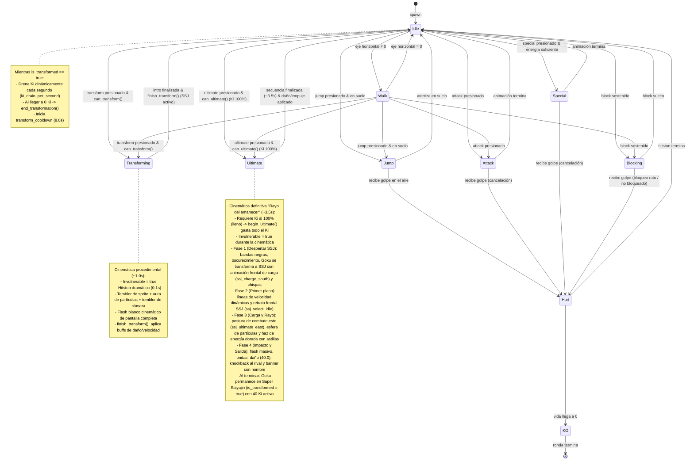
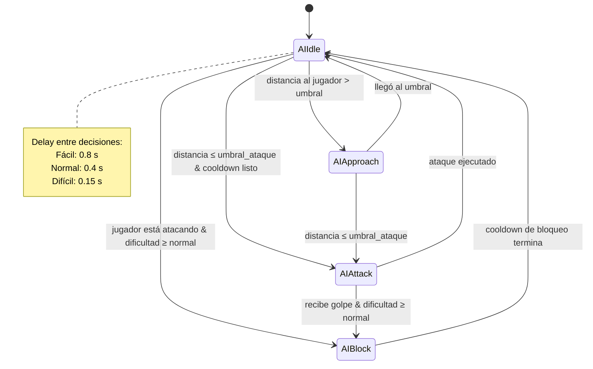
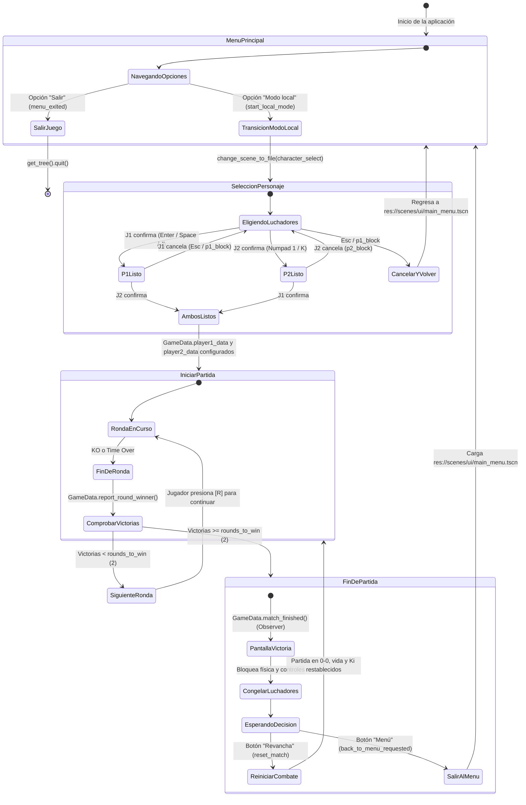

# Diagramas — Juego de Pelea 2D

## 1. Diagrama de Clases

```mermaid
classDiagram
    direction TB

    %% ── Autoloads (Singletons) ──────────────────────────────────────────
    class GameData {
        +all_characters: Array~CharacterData~
        +unlocked_character_ids: Array~String~
        +player1_data: CharacterData
        +player2_data: CharacterData
        +selected_map_id: String
        +round_wins: Dictionary
        +session_coins: int
        +current_mode: GameMode
        +ai_difficulty: int
        +report_round_winner(winner)
        +reset_match()
        +add_coins(amount)
        +is_character_unlocked(id) bool
        +unlock_character(id)
    }

    class SaveManager {
        -SAVE_PATH: String
        +save_game()
        +load_game()
        +get_total_coins() int
        +spend_coins(amount) bool
        +delete_save()
    }

    class CharacterFactory {
        -_SCENE_MAP: Dictionary
        -_scene_cache: Dictionary
        +create_character(data) CharacterBase
        +preload_all()
    }

    class InputManager {
        -ACTIONS: Dictionary
        +is_action_held(player_id, action) bool
        +is_action_just_pressed(player_id, action) bool
        +get_horizontal_axis(player_id) float
    }

    %% ── Resources (Datos) ───────────────────────────────────────────────
    class CharacterData {
        +id: String
        +display_name: String
        +max_health: float
        +max_energy: float
        +move_speed: float
        +jump_force: float
        +damage_basic: float
        +damage_special: float
        +energy_cost_special: float
        +energy_cost_transform: float
        +energy_on_hit_dealt: float
        +energy_on_hit_taken: float
        +transform_duration: float
        +transform_speed_mult: float
        +transform_damage_mult: float
        +transform_name: String
        +ki_drain_per_second: float
        +ki_gain_hit_mult_transformed: float
        +transform_cooldown: float
        +sprite_dir_normal: String
        +sprite_dir_transform: String
        +aura_particle_scene: PackedScene
        +is_locked_by_default: bool
        +unlock_cost: int
    }

    %% ── Personajes ──────────────────────────────────────────────────────
    class CharacterBase {
        +data: CharacterData
        +current_health: float
        +current_energy: float
        +is_transformed: bool
        +is_transforming: bool
        +invulnerable: bool
        +is_facing_right: bool
        +is_blocked: bool
        +take_damage(amount)
        +gain_energy(amount)
        +spend_energy(amount) bool
        +can_transform() bool
        +begin_transform() bool
        +finish_transform()
        +end_transformation()
        +try_transform() bool
        +get_effective_speed() float
        +get_effective_damage(base) float
        +set_facing(right)
        +opponent: Node2D
        +get_opponent() Node2D
        +apply_knockback(force)
        +can_ultimate() bool
        +begin_ultimate() bool
        ~_setup_state_machine()
    }

    class Goku {
        +player_id: int
        +_setup_state_machine()
    }

    class Naruto {
        +player_id: int
        +_setup_state_machine()
    }

    class Madara {
        +player_id: int
        +_setup_state_machine()
    }

    class Vegetto {
        +player_id: int
        +_setup_state_machine()
    }

    class Dummy {
        +start_health: float
        +toggle_guard()
        +simulate_attack_on_goku()
    }

    class Hitbox {
        +owner_character: CharacterBase
        +damage: float
        -_hit_targets: Array
        +activate(dmg)
        +deactivate()
    }

    class Hurtbox {
        +owner_character: CharacterBase
        +receive_hit(damage, attacker)
    }

    %% ── Máquina de Estados ──────────────────────────────────────────────
    class StateMachine {
        +current_state: CharacterState
        -_states: Dictionary
        +init(owner, initial_state)
        +physics_update(delta)
        +process_update(delta)
        +handle_input(event)
        +transition_to(state_name)
    }

    class CharacterState {
        +character: CharacterBase
        +enter()
        +exit()
        +physics_update(delta)
        +process_update(delta)
        +handle_input(event) String
    }

    class IdleState
    class WalkState
    class JumpState
    class AttackState
    class SpecialState
    class BlockState
    class HurtState
    class TransformingState {
        +duration: float
        +transformed_frames: SpriteFrames
        +use_particles: bool
        +enter()
        +exit()
        +physics_update(delta)
    }
    class UltimateState {
        +ultimate_name: String
        +portrait: Texture2D
        +font: Font
        +damage: float
        +knockback: float
        +tint_color: Color
        +beam_color: Color
        +beam_core_color: Color
        +hand_offset: Vector2
        +beam_length: float
        -_rival: Node2D
        +enter()
        -_get_rival()
        -_play_sequence()
        -_closeup(vp)
        -_fire_beam()
        -_impact(vp, dark, bars)
        -_show_banner(vp)
    }
    class TransformedState
    class KOState

    %% ── IA ──────────────────────────────────────────────────────────────
    class EnemyAI {
        +difficulty: int
        +enabled: bool
        +attack_range: float
        +spacing_distance: float
        +character: CharacterBase
        +target: CharacterBase
        +current_ai_state: String
        -_think_timer: float
        -_think_interval: float
        -_block_timer: float
        -_state_timer: float
        +_calibrate_difficulty()
        +_process_ai_state(delta)
        +_decide_next_action(abs_dist, dir)
        +_execute_attack()
        +_is_target_attacking() bool
    }

    %% ── Relaciones ──────────────────────────────────────────────────────
    CharacterBase <|-- Goku
    CharacterBase <|-- Naruto
    CharacterBase <|-- Madara
    CharacterBase <|-- Vegetto
    CharacterBase <|-- Dummy

    CharacterBase "1" *-- "1" StateMachine
    CharacterBase "1" *-- "1" Hitbox
    CharacterBase "1" *-- "1" Hurtbox
    CharacterBase "1" o-- "1" CharacterData

    StateMachine "1" *-- "*" CharacterState
    CharacterState <|-- IdleState
    CharacterState <|-- WalkState
    CharacterState <|-- JumpState
    CharacterState <|-- AttackState
    CharacterState <|-- SpecialState
    CharacterState <|-- BlockState
    CharacterState <|-- HurtState
    CharacterState <|-- TransformingState
    TransformingState <|-- SageTransformingState
    TransformingState <|-- UltimateState
    CharacterState <|-- TransformedState
    CharacterState <|-- KOState

    %% ── HUD y UI (Patrón Observer) ───────────────────────────────────────
    class HealthBarUI {
        +character_path: NodePath
        +is_player_2: bool
        +health_color: Color
        +ghost_color: Color
        +ghost_delay: float
        +ghost_tween_speed: float
        -_ghost_bar: ProgressBar
        -_portrait_panel: Panel
        -_name_label: Label
        +_on_health_changed(current, maximum)
    }

    class EnergyBarUI {
        +character_path: NodePath
        +is_player_2: bool
        +base_energy_color: Color
        +transformed_color: Color
        +bar_height: float
        -_cost_transform: float
        -_hint_label: Label
        -_threshold_marker: ColorRect
        +_on_energy_changed(current, maximum)
        +_on_transformation_started(name)
        +_on_transformation_ended()
    }

    class RoundTimerUI {
        +round_time: float
        +is_timer_active: bool
        -_time_remaining: float
        -_timer_label: Label
        -_round_label: Label
        -_p1_dots: Array
        -_p2_dots: Array
        +_on_round_ended(winner)
    }

    class VictoryScreenUI {
        +overlay_color: Color
        +panel_border_color: Color
        +main_menu_scene_path: String
        -_winner_key: String
        -_lbl_winner: Label
        -_lbl_score: Label
        +setup_victory(winner_key)
        -_freeze_combatants()
        -_restore_combatants()
        -_on_rematch_pressed()
        -_on_menu_pressed()
    }

    class MainMenu {
        +game_title: String
        +local_map_scene_path: String
        +panel_enter_time: float
        +title_enter_time: float
        +option_stagger_delay: float
        +option_slide_time: float
        +breath_cycle_time: float
        -_current_index: int
        -_option_nodes: Array
        +start_local_mode() signal
        +option_selected(name) signal
        +menu_exited() signal
        -_rescale_canvas()
        -_set_selection(index)
        -_activate_current_option()
    }

    class CharacterSelect {
        +combat_scene_path: String
        +main_menu_scene_path: String
        +show_empty_slots: bool
        +grid_columns: int
        +slot_size: float
        +character_scale: Vector2
        +ground_y: float
        -_p1_index: int
        -_p2_index: int
        -_p1_ready: bool
        -_p2_ready: bool
        +characters_confirmed(p1, p2) signal
        +back_to_menu_requested() signal
        -_rescale_canvas()
        -_update_cursors_visuals()
        -_update_p1_display()
        -_update_p2_display()
        -_start_match()
    }

    CharacterBase ..> HealthBarUI : emite health_changed (Observer)
    CharacterBase ..> EnergyBarUI : emite energy_changed y transformation (Observer)
    GameData ..> RoundTimerUI : emite round_ended (Observer)
    GameData ..> VictoryScreenUI : emite match_finished (Observer)
    VictoryScreenUI ..> MainMenu : transiciona a res://scenes/ui/main_menu.tscn
    MainMenu ..> CharacterSelect : transiciona a res://scenes/ui/character_select.tscn
    CharacterSelect ..> GameData : almacena player1_data y player2_data
    CharacterSelect ..> CharacterData : lee estadísticas y alt_tint

    EnemyAI "1" o-- "1" CharacterBase
    EnemyAI "1" *-- "*" AIState

    CharacterFactory ..> CharacterBase : crea
    CharacterFactory ..> CharacterData : usa
    GameData "1" o-- "*" CharacterData
    SaveManager ..> GameData : lee y escribe
    InputManager <.. CharacterBase : consulta
```

---

## 2. Diagrama de Estados — Personaje Jugable



---

## 3. Diagrama de Estados — IA Enemiga



---

## 4. Diagrama de Estados — Ciclo de la Partida y Menú Principal (Game & Match Flow)




